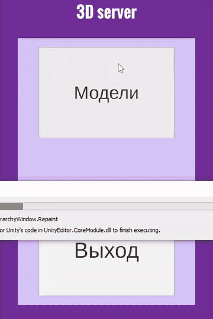

# TestUMD — просмотр 3D-моделей, загружаемых с сервера (Unity)

Тестовое задание: Unity-приложение получает с веб-сервера каталог 3D-моделей
и собирает модели прямо во время работы, по геометрии и текстурам из JSON.

## Что умеет

- **Меню**: «Модели» и «Выход».
- **Каталог моделей**: приложение скачивает `dataBase.json`, затем подгружает
  иконки и строит из них список кнопок.
- **Просмотр модели**: меш собирается из данных JSON (вершины, нормали, UV,
  индексы), на материал накладываются три текстуры: base color, roughness и normal map.
- **Камера**: вращение вокруг модели мышью и зум колёсиком.
- **Подготовка данных** (`Web.cs`): модели из сцены сериализуются в `dataBase.json`,
  который затем раскладывается на сервер.

## Стек

Unity 2021.2.5f1, C#, TextMesh Pro, `JsonUtility`.

## Структура

| Скрипт | Назначение |
|---|---|
| `Mash.cs` | Структуры данных каталога: предметы, меши, материалы |
| `Web.cs` | Экспорт моделей сцены в `dataBase.json` |
| `FromWeb.cs` | Загрузка каталога и текстур, сборка меша и материала |
| `CameraRotateAround.cs` | Орбитальная камера |
| `CreateNewObject.cs`, `OnClickPrefab.cs` | Кнопки каталога |
| `SceneChanger.cs` | Переходы между сценами и выход |

## Запуск

Открыть проект в Unity 2021.2.5f1 и запустить сцену `Menu`. Для работы нужен локальный
веб-сервер, который отдаёт `dataBase.json` и текстуры по адресу
`http://variant-unity-test-server.loc/`. Серверная часть в репозиторий не входит.

## Что бы я сделал иначе сейчас

Это тестовое задание, и сетевая часть в нём сделана упрощённо: по сути это урезанная
копия REST-клиента. Сейчас я бы:

- заменил устаревший `WWW` на `UnityWebRequest` с проверкой статуса ответа. Сейчас условие
  `_www != null` выполняется всегда, поэтому ветка обработки ошибки недостижима;
- вынес адрес сервера и путь экспорта (`C:\WelcomeToHell\...`) в конфиг, а не держал их в коде;
- описал нормальный API (каталог, модель по id, материал по guid), а не отдавал
  всю базу одним JSON-файлом;
- загружал иконки параллельно, а не по очереди;
- убрал статические поля и `FindGameObjectWithTag`: передавал бы зависимости явно
  и не менял общий ассет материала во время работы.
